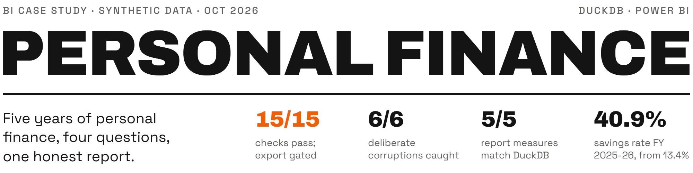
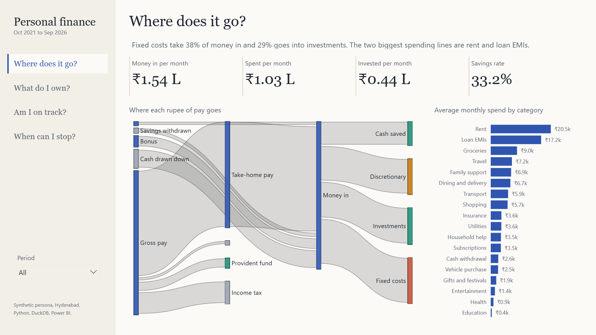

<picture>
  <source media="(max-width: 600px) and (prefers-color-scheme: dark)" srcset=".github/assets/header-phone-dark.png">
  <source media="(max-width: 600px) and (prefers-color-scheme: light)" srcset=".github/assets/header-phone-light.png">
  <source media="(prefers-color-scheme: dark)" srcset=".github/assets/header-dark.png">
  <source media="(prefers-color-scheme: light)" srcset=".github/assets/header-light.png">
  
</picture>

An end-to-end BI case study: synthetic records for a software engineer in Hyderabad, October 2021 to September 2026, modelled and tested in DuckDB and presented as a Power BI report generated from code. It shows the whole chain, from raw bank and payslip exports to a report whose every number is reconciled against the database.

[Case study (PDF)](docs/case-study.pdf) · [Portfolio page](https://damanjz.github.io/portfolio/projects/finance-bi/)

## Results

| Figure | Result | How it is produced |
|---|---|---|
| Reconciliation checks | 15 of 15 pass; the export is blocked if any fails | `sql/checks.sql`, run by `src/pipeline.py` |
| Checks tested by breaking the data | 6 of 6 deliberate corruptions caught | An edited balance, a short EMI, an uncategorised line, an unbalanced flow, a wrong cash figure and a mismatched card bill, each inside a rolled-back transaction ([How it works](docs/how-it-works.pdf), section 3.5) |
| Report measures vs DuckDB | 5 of 5 match | Queried from the running Power BI model with `powerbi/query_desktop.ps1` and compared with DuckDB; table below |
| Savings rate | 40.9% in FY 2025-26, from 13.4% in FY 2021-22 | `mart_monthly` in `data/model`; FY 2021-22 covers six months (October to March) |
| Net worth | ₹44.0 L in September 2026; negative once (−₹0.5 L, March 2023, car purchase) | `mart_monthly` in `data/model` |

| Measure | Power BI | DuckDB |
|---|---|---|
| Average money in per month | ₹1.541836 L | ₹1.541836 L |
| Savings rate, 60 months | 33.222% | 33.222% |
| Debt to income | 9.645% | 9.645% |
| Net worth, Sep 2026 | ₹44.0229 L | ₹44.0229 L |
| FIRE age and corpus | 46, ₹7.8155 Cr | 46, ₹7.8155 Cr |

Source: [case study](docs/case-study.pdf), "Report matches source".

## How it works

| Stage | What happens |
|---|---|
| Generate | A seeded generator writes 10 raw exports: bank, card, payslips, mutual funds, REIT, EPF, PPF, FD and loans |
| Stage and model | DuckDB SQL types the exports into one signed ledger, then a star schema with recursive loan amortisation and month-end holdings and liabilities |
| Marts | Monthly KPIs, net worth, Sankey flows, FIRE inputs and projection |
| Check and export | 15 reconciliation checks (bank balance chain, payroll, loan EMIs, card bills, cashflow identity, Sankey balance); 13 tables are exported only if all pass |
| Report | `powerbi/build_pbip.py` writes the Power BI project (TMDL model, PBIR report) from the schema |

Reviewing the code? Start with [How it works](docs/how-it-works.pdf), a stage-by-stage guide with the design choices worth challenging. The case study is also a [web page](docs/case-study.html).

## What it answers



| Page | Question | Hero visual |
|---|---|---|
| 1 | Where does it go? | Sankey: gross pay through tax and EPF to fixed costs, discretionary, investments and cash |
| 2 | What do I own? | Assets by class over time, allocation at period end |
| 3 | Am I on track? | Savings rate (trailing 12 months), debt to income, emergency cover |
| 4 | When can I stop? | FIRE projection with live sliders for return, inflation and withdrawal rate |

## Findings

From the synthetic persona:

- Savings rate rose from 13.4% (FY 2021-22) to 40.9% (FY 2025-26).
- Net worth went negative once (−₹0.5 L, March 2023, car purchase) and reached ₹44.0 L by September 2026.
- Rent and loan EMIs take 36.6% of all spending.
- ₹7.7 L (17% of assets) sits in cash and FDs, about 7.5 months of spending.
- FIRE at age 46 on 10% return, 6% inflation and 3.5% withdrawal; 44 to 48 across reasonable assumptions.

## Data

All data is synthetic. Market prices are simulated and income tax is an approximation of India's new regime. No real personal data is used.

## Rebuild

Requirements: Python 3.12+, Power BI Desktop (Windows), about 185 MB of disk including the Python environment. The three build scripts run in about 5 seconds (measured 2026-10-12 on Windows; the rebuilt tables match the committed ones).

```bash
python -m venv .venv
.venv/Scripts/pip install -r requirements.txt
.venv/Scripts/python src/generate.py
.venv/Scripts/python src/pipeline.py
.venv/Scripts/python powerbi/build_pbip.py
```

Then open `powerbi/FinanceBI.pbip` in Power BI Desktop and select **Refresh**. `build_pbip.py` writes your local `data/model` path into the model's `DataFolder` parameter. The committed project points to `C:\personal-finance-bi\data\model\`, so a clone at `C:\personal-finance-bi` opens without rebuilding; anywhere else, rebuild or change `DataFolder` in Power Query.

The Sankey uses Microsoft's free [Sankey custom visual](https://github.com/microsoft/powerbi-visuals-sankey) from AppSource, which Power BI loads on first open.

## Repo layout

```
src/generate.py          seeded generator: 10 raw exports (bank, card, payslips, funds, REIT, EPF, PPF, FD, loans)
config/                  categorisation rules (regex, priority) and category groups
sql/01_staging.sql       typed staging, one signed ledger
sql/02_model.sql         star schema, recursive loan amortisation, month-end holdings and liabilities
sql/03_marts.sql         monthly KPIs, net worth, Sankey flows, FIRE inputs and projection
sql/checks.sql           15 reconciliation checks; the export is blocked if any fails
src/pipeline.py          builds DuckDB, runs the checks, exports 13 tables to data/model
powerbi/build_pbip.py    generates the Power BI project (TMDL model + PBIR report) from the schema
powerbi/*.ps1            offline TMDL validation, DAX queries against Desktop, reload and capture helpers
data/                    generated raw exports and the 13 exported tables
docs/                    case study and reviewer guide (HTML and PDF), report images
```

## Limits

- Prices are simulated and tax is approximate.
- FY 2021-22 (October to March) and FY 2026-27 (April to September) are half years; they don't compare with full years.
- The corruption test behind 6 of 6 is described in the guide and the case study, not shipped as a script.
- `DataFolder` is an absolute path; rebuild or edit it when the clone lives elsewhere.
- Built for Power BI Desktop; publishing to the Power BI service needs a work account.

## Licence

MIT, see [LICENSE](LICENSE).
